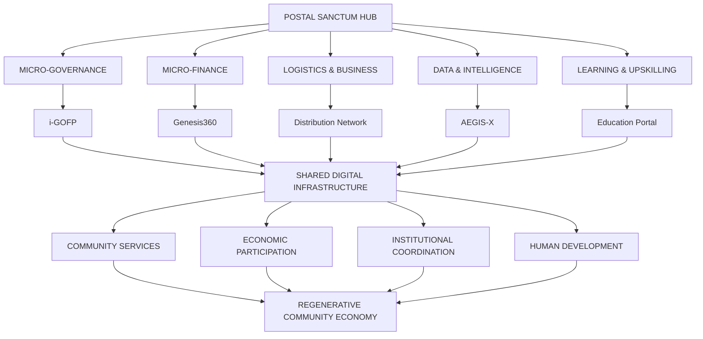
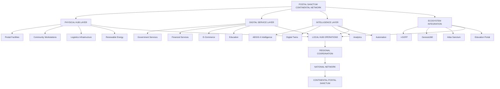
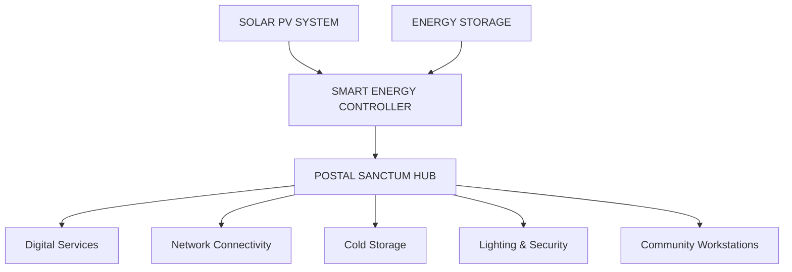

# 🏛️ POSTAL SANCTUM HUBS
## The Future of Civic Infrastructure

### Transforming Africa's Postal Network into Autonomous Centers of Governance, Finance, Logistics, Intelligence, and Learning.

  <strong>ONE CONTINENTAL NETWORK. DISTRIBUTED COMMUNITY INTELLIGENCE. UNIVERSAL ACCESS.</strong>
   
  <em>Reimagining the post office as the front door to Africa's digital and regenerative future.</em>

  <a href="#-vision">Vision</a> •
  <a href="#-five-core-functions">Core Functions</a> •
  <a href="#-system-architecture">Architecture</a> •
  <a href="#-ecosystem-integration">Ecosystem</a> •
  <a href="#-pilot-program">Pilot Program</a> •
  <a href="#-roadmap">Roadmap</a>

---

> "The postal office becomes Africa's new front door to digital governance, regenerative finance, and ethical innovation — a sanctum of service where the future meets the village."

---

# 🌍 01. The Vision

Africa possesses an extensive network of postal infrastructure connecting cities, towns, rural communities, businesses, and public institutions.

Yet much of the potential of this infrastructure remains underutilized in an increasingly digital economy.

At the same time, millions of people and businesses face barriers to accessing essential services:

- Fragmented digital service delivery.
- Limited financial inclusion.
- Inefficient last-mile logistics.
- Restricted access to digital skills and employment opportunities.
- Inadequate connectivity between rural and urban markets.
- Limited transparency in local service delivery.
- Insufficient access to innovation infrastructure.

**Postal Sanctum Hubs** proposes a new purpose for Africa's postal infrastructure.

We envision transforming existing postal offices into connected, intelligent, and increasingly self-sustaining community infrastructure centers.

Each hub becomes a local gateway to:

- Digital government services.
- Financial inclusion and regenerative finance.
- E-commerce and logistics.
- Community intelligence.
- Education and skills development.
- Entrepreneurship and innovation.
- Renewable energy and digital connectivity.

Rather than creating entirely new physical networks, Postal Sanctum seeks to activate and modernize existing infrastructure through technology, institutional partnerships, and community participation.

**Our mission is to transform the traditional post office into a foundational institution of the digital age.**

---

# 🧭 02. The Mission

Postal Sanctum Hubs aims to establish a distributed continental network of intelligent civic infrastructure.

The model brings together five essential functions within one physical and digital environment.

| Pillar | Mission |
|---|---|
| Micro-Governance | Bring public services closer to communities |
| Micro-Finance | Expand access to responsible digital financial services |
| Logistics & Business | Connect local businesses to broader markets |
| Data & Intelligence | Improve community insight and service coordination |
| Learning & Upskilling | Expand access to knowledge, skills, and opportunity |

Each hub operates as a local node within a wider interconnected ecosystem.

### The Foundational Principle

**Existing infrastructure + digital intelligence + institutional collaboration = distributed civic transformation.**

---

# 🏛️ 03. Five Core Functions, One Hub

## I. Micro-Governance Center
### Powered by i-GOFP

The Micro-Governance Center provides a local access point for digital public services and community participation.

It explores how postal infrastructure can support more accessible, transparent, and responsive governance.

### Core Capabilities

**Digital Identity Access**
- Assisted identity verification workflows.
- Secure access to authorized government services.
- Digital document support.
- Identity-related service navigation.

**Government Fee Processing**
- Digital payment initiation.
- Government service fee collection through authorized integrations.
- Payment confirmation.
- Digital receipts.
- Transaction reconciliation.

**Community Engagement**
- Citizen feedback channels.
- Community consultations.
- Public service surveys.
- Local development proposals.
- Participatory governance initiatives.

**Performance Intelligence**
- Local service delivery dashboards.
- Service availability monitoring.
- Community feedback analytics.
- Operational performance indicators.
- Public accountability reporting.

### i-GOFP Integration

i-GOFP provides the proposed digital governance and institutional coordination framework.

Its role is to support the connection between citizens, public services, institutions, and community-level decision-making.

**Philosophy:**

Governance should not feel distant. Essential public services should become more accessible to the communities they serve.

---

## II. Micro-Finance & Digital Economy
### Powered by Genesis360

The Micro-Finance function connects communities to digital financial services and opportunities for economic participation.

It seeks to make postal hubs accessible entry points into the wider digital economy.

### Core Capabilities

**Digital Wallets**
- Digital payment access.
- Supported transaction services.
- Wallet management.
- Transaction histories.
- Merchant payment integrations.

**Micro-Insurance**
- Access to eligible insurance products.
- Digital policy information.
- Premium payment workflows.
- Claims submission assistance.
- Insurance education.

**Regenerative Finance**
- Savings and financial literacy.
- Responsible lending integrations.
- Community funding.
- Regenerative project participation.
- Sustainable investment discovery.

**Ethical Remittances**
- Assisted remittance workflows.
- Transparent transaction fees.
- Supported domestic and cross-border transfers.
- Digital transaction records.

**E-Commerce Access**
- Merchant onboarding.
- Digital commerce support.
- Business payment integrations.
- Marketplace access.

### Genesis360 Integration

Genesis360 provides the conceptual superapp and financial services integration layer.

It connects everyday community needs with financial, commercial, and digital services.

**Philosophy:**

Financial inclusion should enable people to participate in economic life with greater agency, transparency, and opportunity.

Regulated financial activities must be delivered through appropriately authorized partners.

---

## III. Logistics & Business Accelerator
### Powered by Distribution Network

The Logistics and Business Accelerator transforms postal facilities into modern last-mile commerce and distribution centers.

It connects local producers, entrepreneurs, retailers, customers, and wider supply chains.

### Core Capabilities

**E-Commerce Distribution**
- Parcel collection.
- Last-mile delivery coordination.
- Digital order tracking.
- Merchant dispatch services.
- Delivery management.

**Packaging Infrastructure**
- Packaging stations.
- Product preparation.
- Parcel labeling.
- Standardized packaging workflows.
- Merchant shipping assistance.

**Cold-Chain Hubs**
- Temperature-controlled storage.
- Agricultural product handling.
- Perishable goods distribution.
- Cold-chain monitoring.
- Local producer connections.

**Urban-Rural Trade**
- Rural merchant onboarding.
- Agricultural market connections.
- Regional distribution.
- Cross-community commerce.
- Market access coordination.

**SME Support**
- Business resource centers.
- Digital commerce training.
- Logistics advisory.
- Market discovery.
- Entrepreneur networking.

### Distribution Network Integration

The Distribution Network connects individual postal facilities to a broader logistics ecosystem.

Each hub can function as a local consolidation and distribution node.

**Philosophy:**

A rural entrepreneur should not be disconnected from opportunity simply because they are geographically distant from major commercial centers.

---

## IV. Data & Community Intelligence
### Powered by AEGIS-X

The Data and Community Intelligence function creates an analytical environment for understanding community needs, infrastructure performance, and local development conditions.

AEGIS-X provides the proposed intelligence and analytics framework.

### Core Capabilities

**Community Analytics**
- Aggregate community indicators.
- Service utilization metrics.
- Local economic activity.
- Development indicators.
- Resource accessibility.

**Community Sentiment**
- Voluntary feedback collection.
- Public consultation analysis.
- Community concerns.
- Service satisfaction indicators.
- Language-aware analysis.

**Early-Warning Systems**
- Environmental risk monitoring.
- Service disruption alerts.
- Infrastructure status.
- Community emergency information.
- Weather-related warnings.

**Climate Intelligence**
- Environmental observations.
- Local climate information.
- Agricultural risk indicators.
- Water-related information.
- Sustainability project monitoring.

**Operational Intelligence**
- Hub performance.
- Service utilization.
- Logistics activity.
- Financial service availability.
- Infrastructure monitoring.

### AEGIS-X Integration

AEGIS-X supports the intelligence layer connecting local observations, institutional information, and decision-support systems.

Its purpose is to make community intelligence more accessible and useful for responsible planning.

**Philosophy:**

Communities should not merely generate data. They should benefit from the intelligence created through it.

Sensitive information must be collected lawfully, used transparently, and protected against surveillance, discrimination, and unauthorized access.

---

## V. Learning & Upskilling Sanctum
### Powered by Education Portal

The Learning and Upskilling Sanctum transforms postal facilities into accessible centers for digital literacy, professional development, and lifelong learning.

It provides physical access to digital educational opportunities, particularly in communities with limited access to innovation infrastructure.

### Core Capabilities

**AI Literacy**
- Introduction to artificial intelligence.
- Responsible AI education.
- Digital productivity tools.
- Practical AI workshops.
- Community technology awareness.

**Skills Training**
- Digital skills development.
- Software development.
- Entrepreneurship.
- Financial literacy.
- Business management.
- Technology-enabled employment skills.

**Remote Work Hub**
- Digital workstations.
- Internet access.
- Remote interview facilities.
- Professional development support.
- Online collaboration environments.

**Wisdom Workshops**
- Critical thinking.
- Ethics and responsible innovation.
- Community leadership.
- Financial responsibility.
- Philosophy and lifelong learning.

### Education Portal Integration

The Education Portal provides the proposed digital learning environment connecting individuals to educational resources, training opportunities, and innovation programs.

**Philosophy:**

Every postal hub should become a doorway to knowledge, skills, and new possibilities.

---

# 🧬 04. The Five-Function Integration

The strength of Postal Sanctum lies in the integration of its five functions.

Instead of creating five isolated services, the hub brings them together within one accessible community environment.

### A Connected Community Journey

A local entrepreneur could:

1. Visit the hub to register a business-related service request.
2. Access appropriate digital financial services.
3. Receive support with digital commerce onboarding.
4. Use postal logistics for product distribution.
5. Access business training.
6. Track performance through available analytics.

A farmer could:

1. Access digital market information.
2. Receive assistance connecting to buyers.
3. Use collection and packaging infrastructure.
4. Arrange supported product distribution.
5. Explore appropriate financial and insurance services.
6. Access agricultural and climate-related information.

This is the practical value of integration: one community location, multiple interconnected opportunities.

---

# ⚡ 05. Autonomous Postal Offices
## Distributed Infrastructure for the Autonomous Age

Postal Sanctum introduces the concept of the autonomous postal office.

Each hub is designed to operate as an increasingly intelligent, connected, and financially sustainable service node.

Autonomy refers to the progressive automation of suitable operational workflows, not the elimination of human responsibility or the replacement of essential human service personnel.

### I. Autonomous Workflows

Potential capabilities:

- Automated service routing.
- Digital queue management.
- Transaction reconciliation.
- Parcel tracking.
- Service request classification.
- Administrative workflow automation.
- Inventory monitoring.

### II. AI-Assisted Services

AI-enabled systems can support:

- Customer service assistance.
- Document navigation.
- Service discovery.
- Community information retrieval.
- Logistics planning.
- Operational decision support.

Human assistance must remain available for sensitive, complex, and consequential transactions.

### III. Digital Twins

Each hub can have a digital representation of its operational environment.

Potential monitoring domains:

- Energy consumption.
- Internet connectivity.
- Equipment condition.
- Parcel inventory.
- Service availability.
- Facility utilization.
- Operational performance.

### IV. Energy Independence

Postal Sanctum explores sustainable microgrids to support reliable operations, especially in locations with unstable electricity supply.

Potential infrastructure:

- Solar photovoltaic systems.
- Battery storage.
- Smart energy management.
- Backup power systems.
- Energy-efficient equipment.
- Remote power monitoring.

### V. Self-Sustaining Operations

The financial model explores multiple complementary revenue sources.

Potential sources include:

- Parcel and logistics services.
- Authorized payment service commissions.
- Business support services.
- Digital access facilities.
- Training programs.
- Cold-chain services.
- Commercial partnerships.
- Public service delivery contracts.

The goal is to improve the economic sustainability of each hub while preserving affordable access to essential community services.

---

# 🌍 06. The Renaissance Moment
## Why Postal Infrastructure, Why Now?

Africa's postal networks occupy an important intersection between public infrastructure, community access, and digital transformation.

They offer an existing institutional foundation that can potentially support new forms of service delivery.

### The Gaps

| Challenge | Community Consequence |
|---|---|
| Weak last-mile service delivery | Difficult access to essential public services |
| Fragmented digital access | Exclusion from connected economic systems |
| Slow e-commerce logistics | Higher barriers for local businesses |
| Limited financial inclusion | Restricted economic participation |
| Poor governance visibility | Reduced service transparency |
| Rural youth unemployment | Limited access to skills and opportunities |

### The Postal Sanctum Opportunity

| Existing Advantage | Proposed Transformation |
|---|---|
| Physical postal facilities | Integrated community service centers |
| Established service locations | Digital access infrastructure |
| Postal distribution networks | Modern e-commerce logistics |
| Institutional relationships | Coordinated digital public services |
| Existing customer networks | Financial and business inclusion |
| Physical community presence | Learning and innovation centers |

### The 90% Reach Vision

The supplied concept references approximately 90% physical coverage across Africa.

This is an ambition and an interface-level claim requiring a clearly defined geographical baseline, postal-network source, and country-by-country verification before being presented as an established continental coverage statistic.

The broader strategic thesis is that existing postal networks may offer a substantial foundation for expanding digital access without rebuilding every physical distribution channel from scratch.

---

# 🏗️ 07. System Architecture

Postal Sanctum is envisioned as a distributed architecture connecting physical hubs, local service infrastructure, central coordination systems, and ecosystem applications.

### Conceptual Architecture

### Operational Layers

| Layer | Function |
|---|---|
| Physical Infrastructure | Facilities, equipment, energy, and connectivity |
| Service Delivery | Governance, finance, logistics, and education |
| Application Infrastructure | Shared digital services and interfaces |
| Intelligence Infrastructure | Analytics, AI, and operational monitoring |
| Integration Infrastructure | External institutions and ecosystem partners |
| Governance Infrastructure | Accountability, security, and institutional oversight |

---

# 🧠 08. The Postal Sanctum Digital Twin

Every participating hub can be represented through a digital operational twin.

The objective is to understand how each facility performs and identify opportunities to improve service delivery.

### Hub Intelligence Dashboard

Potential indicators:

| Domain | Monitoring Indicators |
|---|---|
| Governance | Service requests and processing status |
| Finance | Transaction activity and reconciliation |
| Logistics | Parcel throughput and delivery performance |
| Community | Service participation and feedback |
| Learning | Training attendance and completion |
| Energy | Power generation and consumption |
| Infrastructure | Equipment health and availability |

### Digital Twin Capabilities

- Operational monitoring.
- Service availability.
- Equipment health.
- Energy optimization.
- Logistics visibility.
- Resource planning.
- Performance forecasting.
- Maintenance scheduling.

Each digital twin should reflect actual operational data, with suitable access controls and clearly defined data freshness.

---

# ⚡ 09. Energy Independence & Sustainable Infrastructure

Reliable energy is essential for the continuous operation of digital services and logistics facilities.

Postal Sanctum explores renewable microgrids as part of its infrastructure strategy.

### Potential Energy Architecture

### Sustainability Objectives

- Improve energy reliability.
- Reduce operational energy costs.
- Support rural digital infrastructure.
- Enable appropriate cold-chain services.
- Reduce dependence on unreliable electricity supply.
- Explore local renewable energy partnerships.

Each hub's energy system should be sized according to its real operational requirements and local energy conditions.

---

# 🤝 10. Ecosystem Integration
## One Network. Complementary Intelligence.

Postal Sanctum is envisioned as a physical implementation layer for the wider Atlas Sanctum and Holy Spirit Innovation Ecosystem.

It connects specialized platforms into one community-facing institutional environment.

### AEGIS-X
**Ethical Intelligence**

Provides the proposed intelligence, analytics, and responsible AI layer.

Role:
- Community intelligence.
- Operational analytics.
- Environmental monitoring.
- Early-warning support.
- AI-assisted service coordination.

### Genesis360
**Superapp Services**

Provides the proposed financial and digital service environment.

Role:
- Digital wallets.
- Merchant services.
- Micro-finance integrations.
- Service discovery.
- Community commerce.
- Regenerative value participation.

### i-GOFP
**Digital Governance**

Provides the proposed governance and public-service coordination layer.

Role:
- Digital public services.
- Institutional workflows.
- Citizen engagement.
- Public service visibility.
- Community performance intelligence.

### Atlas Sanctum
**Philosophy & Design**

Provides the broader institutional philosophy of stewardship, regenerative prosperity, human dignity, and accountable innovation.

Role:
- Ethical foundations.
- Regenerative design principles.
- Institutional coordination.
- Community-centered development.
- Long-term civilizational vision.

### Integration Overview

| Ecosystem | Postal Sanctum Function |
|---|---|
| AEGIS-X | Intelligence and operational analytics |
| Genesis360 | Financial and digital services |
| i-GOFP | Governance and civic access |
| Atlas Sanctum | Philosophy, design, and stewardship |

---

# 🗺️ 11. The Postal Corridor of Autonomy
## A Distributed African Pilot Strategy

Postal Sanctum proposes a phased pilot model.

The first stage is to identify three to five suitable postal facilities, transform them into modern integrated hubs, measure their performance, and refine the operating model before larger expansion.

### Proposed Pilot Regions

#### 🇰🇪 Kenya — Rift Valley

Potential focus:
- Agricultural market access.
- Rural digital services.
- Community financial inclusion.
- Education and technology access.
- Logistics coordination.

#### 🇬🇭 Ghana — Ashanti Region

Potential focus:
- SME digitization.
- Public service access.
- Community financial services.
- Distribution and logistics.
- Youth innovation.

#### 🇳🇬 Nigeria — Southwest Belt

Potential focus:
- Digital commerce.
- Last-mile distribution.
- Small business infrastructure.
- Financial technology.
- Community service integration.

#### 🇹🇿 Tanzania — Coastal Region

Potential focus:
- Urban-rural logistics.
- Agricultural value chains.
- Digital public service access.
- Community connectivity.
- Local entrepreneurship.

These are proposed pilot geographies, not confirmed deployment locations or institutional agreements.

### Pilot Deployment Strategy

**Stage 1 — Assessment**

Evaluate facility readiness, community demand, infrastructure conditions, postal network capacity, and institutional authorization.

**Stage 2 — Transformation**

Equip selected locations with digital workstations, connectivity, service infrastructure, payment integrations, and appropriate energy systems.

**Stage 3 — Integration**

Connect the five functional systems and establish local operational workflows.

**Stage 4 — Validation**

Measure utilization, service quality, financial performance, community satisfaction, and operating costs.

**Stage 5 — Expansion**

Improve the deployment model and extend to additional facilities based on demonstrated performance.

---

# 📊 12. Pilot Success Metrics

Postal Sanctum aims to evaluate success through a balanced framework covering economic sustainability, service accessibility, business development, and operational performance.

### Demonstration Targets

| Metric | Vision Target |
|---|---:|
| Revenue Growth | +150% |
| Service Access | +300% |
| SME Activity | +200% |
| Initial Pilot Hubs | 5 |

These figures are aspirational interface targets, not demonstrated pilot outcomes. Each metric requires a defined baseline, measurement period, calculation method, and independently reviewable data.

### Recommended Operational Indicators

**Financial Sustainability**
- Revenue per hub.
- Operating cost per hub.
- Revenue diversification.
- Transaction volume.
- Service-level profitability.

**Service Accessibility**
- Number of users served.
- Services available.
- Processing time.
- Geographic accessibility.
- Customer satisfaction.

**Business Development**
- SMEs onboarded.
- Merchants supported.
- Parcels processed.
- Local businesses reached.
- Entrepreneur training participation.

**Community Development**
- Training completions.
- Youth employment connections.
- Digital literacy participation.
- Community feedback.
- Access to public services.

**Infrastructure Performance**
- Facility availability.
- Internet uptime.
- Energy reliability.
- Equipment utilization.
- Logistics performance.

---

# 🏛️ 13. Public-Private-Moral Partnership Model

Postal Sanctum explores a collaborative institutional model connecting public infrastructure, private technology, and ethical stewardship.

The concept is intended to bring different forms of expertise and accountability together.

### Public Institutions

Potential contributions:
- Access to authorized postal facilities.
- Public service integration.
- Institutional oversight.
- Regulatory coordination.
- Community service alignment.

### Private Sector

Potential contributions:
- Digital infrastructure.
- Technology development.
- Payment integrations.
- Logistics expertise.
- Operational investment.
- Service innovation.

### Community & Ethical Institutions

Potential contributions:
- Community participation.
- Local accountability.
- Digital literacy.
- Social safeguards.
- Inclusive service design.
- Ethical oversight.

### Partnership Principle

No single participant should exercise unchecked control over essential community infrastructure.

Governance arrangements should clearly define responsibilities, data rights, service obligations, financial accountability, and public-interest protections.

---

# 🧭 14. Governance, Privacy & Security

Because Postal Sanctum touches public services, financial activity, identity verification, community intelligence, and education, trust must be foundational.

### Security Principles

**Identity Protection**
- Authorized identity verification.
- Secure authentication.
- Role-based access control.
- Appropriate identity data minimization.

**Financial Security**
- Secure payment integrations.
- Transaction authorization.
- Fraud monitoring.
- Reconciliation.
- Audit trails.

**Data Protection**
- Encryption in transit and at rest.
- Privacy-preserving analytics.
- Defined data retention.
- Controlled data sharing.
- Security incident response.

**Responsible AI**
- Transparent recommendations.
- Human oversight.
- Documented model limitations.
- Bias evaluation.
- Appropriate review of consequential decisions.

**Community Sovereignty**
- Transparent data practices.
- Community participation.
- Appropriate consent.
- Clear grievance mechanisms.
- Protection against surveillance and misuse.

### Operational Governance

Each hub should have clearly documented operating responsibilities, escalation procedures, financial controls, data governance requirements, and service accountability mechanisms.

Public-service and regulated financial integrations must comply with applicable national laws and institutional requirements.

---

# 💰 15. Economic Sustainability Model

Postal Sanctum aims to develop a diversified operating model that can support the sustainability of individual facilities.

### Potential Revenue Streams

| Service | Potential Revenue Model |
|---|---|
| Parcel Services | Delivery and handling fees |
| E-Commerce | Merchant and distribution service fees |
| Digital Payments | Authorized provider commissions |
| Business Support | SME services and workspace fees |
| Cold Chain | Storage and handling fees |
| Training | Sponsored programs and training contracts |
| Public Services | Authorized service-delivery agreements |
| Technology Services | Institutional and enterprise contracts |

### Financial Sustainability Principles

- Transparent service pricing.
- Affordable community access.
- Diversified revenue.
- Measurable operating costs.
- Local employment.
- Responsible partnerships.
- Sustainable maintenance funding.
- Clear separation of public services and commercial activities.

The goal is not to privatize essential public infrastructure, but to explore responsible models that improve its accessibility, productivity, and long-term financial resilience.

---

# 🧪 16. Innovation & Research Opportunities

Postal Sanctum creates opportunities for research and experimentation across multiple disciplines.

| Research Domain | Opportunity |
|---|---|
| Digital Public Infrastructure | Connected community service delivery |
| Fintech | Financial inclusion and digital payment systems |
| Logistics Engineering | Last-mile distribution optimization |
| Artificial Intelligence | Responsible service automation |
| Energy Systems | Renewable microgrid deployment |
| Development Economics | Sustainable community infrastructure |
| Cybersecurity | Secure public-service infrastructure |
| Digital Governance | Participatory institutional systems |
| Human-Computer Interaction | Inclusive digital service experiences |
| Regenerative Economics | Local economic and environmental value creation |

The postal hub becomes not only a service center, but also a practical environment for applied innovation.

---

# ⚙️ 17. Technical Architecture & Engineering Direction

Postal Sanctum requires an interoperable architecture capable of supporting many independently developed services.

### Conceptual Technical Architecture

```mermaid
flowchart TB
    A["POSTAL SANCTUM DIGITAL PLATFORM"]

    A --> B["USER EXPERIENCE"]
    A --> C["APPLICATION SERVICES"]
    A --> D["INTELLIGENCE SERVICES"]
    A --> E["INTEGRATION SERVICES"]
    A --> F["INFRASTRUCTURE"]

    B --> B1["Citizen Portal"]
    B --> B2["Merchant Portal"]
    B --> B3["Hub Operator Dashboard"]
    B --> B4["Institutional Dashboard"]

    C --> C1["Governance Services"]
    C --> C2["Finance Services"]
    C --> C3["Logistics Services"]
    C --> C4["Learning Services"]

    D --> D1["AEGIS-X"]
    D --> D2["Analytics"]
    D --> D3["Digital Twins"]
    D --> D4["AI Workflows"]

    E --> E1["Payment APIs"]
    E --> E2["Government APIs"]
    E --> E3["Postal Systems"]
    E --> E4["Partner Platforms"]

    F --> F1["Hub Edge Devices"]
    F --> F2["Cloud Infrastructure"]
    F --> F3["Connectivity"]
    F --> F4["Energy Monitoring"]

    B --> G["CONTINENTAL COORDINATION LAYER"]
    C --> G
    D --> G
    E --> G
    F --> G
```

### Engineering Priorities

- Modular service architecture.
- Interoperable APIs.
- Offline-aware workflows.
- Secure transaction processing.
- Distributed infrastructure management.
- Edge computing.
- Reliable data synchronization.
- Operational observability.
- Identity and access management.
- Privacy-preserving analytics.
- Resilient power and connectivity.

Individual hubs should be capable of delivering essential functions during limited connectivity, with controlled synchronization when network access returns.

The actual engineering stack should be documented according to implemented technologies.

---

# 🗺️ 18. Development Roadmap

## Phase I — Foundational Pilot

- [ ] Identify suitable pilot facilities.
- [ ] Assess facility and network readiness.
- [ ] Establish institutional partnerships.
- [ ] Develop Postal Sanctum design standards.
- [ ] Build the central digital platform.
- [ ] Define operating and governance frameworks.

## Phase II — Digital Service Integration

- [ ] Develop digital governance access.
- [ ] Integrate supported payment providers.
- [ ] Establish merchant service workflows.
- [ ] Introduce parcel and logistics management.
- [ ] Develop community service dashboards.

## Phase III — Intelligence & Automation

- [ ] Integrate AEGIS-X.
- [ ] Develop hub digital twins.
- [ ] Introduce operational analytics.
- [ ] Build service automation.
- [ ] Develop early-warning integrations.
- [ ] Establish data governance mechanisms.

## Phase IV — Financial & Business Ecosystem

- [ ] Integrate Genesis360 services.
- [ ] Establish authorized financial partnerships.
- [ ] Introduce appropriate micro-insurance offerings.
- [ ] Build SME support infrastructure.
- [ ] Establish regenerative finance integrations.

## Phase V — Learning & Energy Independence

- [ ] Deploy Education Portal.
- [ ] Introduce AI literacy programs.
- [ ] Establish remote work facilities.
- [ ] Develop renewable energy infrastructure.
- [ ] Integrate energy monitoring.

## Phase VI — National Expansion

- [ ] Evaluate pilot performance.
- [ ] Standardize hub deployment.
- [ ] Expand across participating national postal networks.
- [ ] Establish regional coordination.
- [ ] Develop additional institutional integrations.

## Phase VII — Continental Network

- [ ] Establish interoperable hub infrastructure.
- [ ] Expand regional partnerships.
- [ ] Develop cross-border logistics capabilities.
- [ ] Support continental knowledge exchange.
- [ ] Explore Africa-wide service coordination.

*These milestones describe the proposed development trajectory, not confirmed completed deployments.*

---

# 🤝 19. Partnerships & Collaboration

Postal Sanctum is designed to grow through collaboration among institutions that share an interest in accessible, resilient, and community-centered infrastructure.

### Potential Partners

- National postal operators.
- Government ministries.
- County and municipal authorities.
- Financial institutions.
- Licensed payment providers.
- Insurance companies.
- Logistics and e-commerce businesses.
- Universities and TVET colleges.
- Renewable energy providers.
- Technology companies.
- Community organizations.
- Development institutions.

### Partnership Opportunities

**Launch a Pilot**

Transform selected postal facilities into integrated service hubs.

**Technology Partnership**

Provide infrastructure, APIs, digital platforms, and intelligent systems.

**Financial Partnership**

Enable secure and authorized digital financial services.

**Logistics Partnership**

Connect local hubs with wider supply chains and distribution networks.

**Education Partnership**

Develop training, digital literacy, and entrepreneurship programs.

**Research Partnership**

Evaluate the economic, institutional, and social impact of the model.

---

# 🌍 20. The Continental Vision

Imagine a network of intelligent community hubs connecting people and institutions across Africa.

A farmer in rural Kenya can access digital services, agricultural information, and logistics support.

A young entrepreneur in Ghana can reach new customers and access business training.

A small business in Nigeria can connect to a wider distribution network.

A community in Tanzania can access public services, digital financial infrastructure, and learning opportunities.

Each facility remains locally grounded while participating in a broader continental network.

This is the future Postal Sanctum seeks to explore.

**From the village to the city. From the local community to the continental network.**

---

# 🤝 21. Contributing

We welcome developers, researchers, entrepreneurs, institutional partners, policymakers, and community innovators.

### Contribution Areas

- Digital public infrastructure.
- Fintech and payments.
- Logistics and distribution.
- Artificial intelligence.
- Cybersecurity.
- Renewable energy.
- Digital identity.
- Data engineering.
- Education technology.
- Community development.
- Regenerative finance.
- Public-sector innovation.

### Contribution Process

1. Explore the repository.
2. Review available documentation.
3. Identify an opportunity or technical challenge.
4. Discuss significant architectural changes.
5. Submit contributions with appropriate tests and documentation.

Contribution guidelines will evolve as the development ecosystem expands.

---

# 📜 22. License

The repository license has not yet been specified.

An appropriate license should be selected before establishing public redistribution, commercial-use, and contribution terms.

---

# 🕊️ 23. Our Declaration

We believe existing infrastructure can become the foundation of new possibilities.

We believe public services should be accessible to every community.

We believe financial systems should empower rather than exclude.

We believe logistics should connect rather than fragment economies.

We believe intelligence should strengthen human dignity and institutional responsibility.

We believe knowledge should travel beyond the walls of major cities.

We believe the future of Africa must be built with its communities, not merely delivered to them.

The traditional post office was a gateway for letters, parcels, and communication.

The Postal Sanctum Hub reimagines that gateway for an interconnected world.

---

# 🏛️ POSTAL SANCTUM HUBS

## The Future of Civic Infrastructure.

### From Postal Networks to Regenerative Community Intelligence.

**One Hub. Five Functions. A Continental Network.**

  <strong>POSTAL SANCTUM</strong>
   
  <em>GOVERNANCE. FINANCE. LOGISTICS. INTELLIGENCE. LEARNING.</em>
    
  🌍 Building Africa's distributed infrastructure for the autonomous age.
    
  A new civilizational model for the autonomous age.

